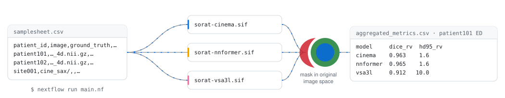

# SORAT

SORAT (Segmentation Orchestration and Reproducible Analysis Toolkit) is a Nextflow pipeline that runs several cardiac MRI segmentation models on the same scans and scores their predictions in one consistent way.

[](https://www.nextflow.io/)
[](https://apptainer.org/)
[](LICENSE)

<picture>
  <source media="(prefers-color-scheme: dark)" srcset="docs/assets/sorat-workflow-dark.svg">
  
</picture>

Published segmentation models each come with their own preprocessing, label values and evaluation scripts, so their reported accuracies are hard to compare. SORAT runs every model in its own container. It reads end-diastolic and end-systolic frames from `Info.cfg` and checks them against the dataset's phase images. It maps each model's labels to a common set, resamples every prediction back to the spacing, origin and orientation of the input image, and computes the metrics with a single, unit-tested implementation. The same run can also produce clinical measurements (volumes, ejection fraction, myocardial mass, wall thickness) and per-subject reports.

## Models

| Model | Input | Output labels | Reference |
|---|---|---|---|
| CineMA, fine-tuned on ACDC, M&Ms-1 and M&Ms-2 (3 seeds each, plus majority-vote ensembles) | Short-axis cine | 1 RV, 2 myocardium, 3 LV | [Fu et al., 2026](https://doi.org/10.1038/s43856-026-01636-0) |
| nnFormer, ACDC model | Short-axis cine | 1 RV, 2 myocardium, 3 LV | [Zhou et al., 2023](https://doi.org/10.1109/TIP.2023.3293771) |
| VSA-3L, MONAI model zoo | Short-axis cine | 1 RV, 2 myocardium, 3 LV | [Kerfoot et al., 2019](https://doi.org/10.1007/978-3-030-12029-0_40) |
| Atrial nnU-Net, trained on MBAS 2024 | 3-D LGE | 1 wall, 2 RA, 3 LA | [Isensee et al., 2021](https://doi.org/10.1038/s41592-020-01008-z) |

To add another model, see [Adding a model](docs/adding-a-model.md).

## Getting started

You need Nextflow 23.04 or later, Apptainer, and an NVIDIA GPU. The model images, weights included, are on Docker Hub:

```bash
git clone https://github.com/CompBio-Lab/SORAT.git && cd SORAT
python3 bin/sorat_setup.py      # records your data paths and SLURM account in .sorat/user.config

apptainer pull containers/sorat-cinema.sif   docker://parsaban/sorat-cinema:v100-sm70
apptainer pull containers/sorat-nnformer.sif docker://parsaban/sorat-nnformer:v100-sm70
apptainer pull containers/sorat-vsa3l.sif    docker://parsaban/sorat-vsa3l:v100-sm70
```

List the scans in a samplesheet. Only `patient_id` and `image` are required; without `ground_truth` SORAT only segments, and without `info_cfg` it segments every frame.

```csv
patient_id,image,ground_truth,info_cfg
patient101,/data/acdc/patient101/patient101_4d.nii.gz,/data/acdc/patient101,/data/acdc/patient101/Info.cfg
```

Then run it locally or on a SLURM cluster:

```bash
nextflow run main.nf -profile local --input samplesheet.csv --models cinema,nnformer --outdir results
nextflow run main.nf -profile slurm --slurm_account <account> --input samplesheet.csv --models all \
    --evaluation.gt_label_map 'rv=1,myo=2,lv=3'
```

Predictions are written to `results/<model>/segmentations/`, and the metrics for every model, subject and frame to `results/comparison/aggregated_metrics.csv`, alongside an HTML comparison report.

## Documentation

- [Installation](docs/installation.md): requirements, container images, building images and checking the GPU runtime
- [Usage](docs/usage.md): samplesheets, frames, label maps, evaluation options and profiles
- [Parameters](docs/parameters.md): every pipeline option
- [Features](docs/features.md): clinical measurements and radiomics
- [Outputs](docs/outputs.md): the results folder
- [Adding a model](docs/adding-a-model.md)
- [Reproducing the paper](paper/README.md)

## Development

The tests use `unittest` and need NumPy, SimpleITK and MedPy, so run them inside a model container:

```bash
apptainer exec containers/sorat-cinema.sif python -m unittest discover -s tests -v
```

## Citation and license

A manuscript describing SORAT is in preparation; until it is published, please cite this repository and the models you use. SORAT is released under the [MIT License](LICENSE). The CineMA and nnFormer code included in `cinema/` and `nnformer/` keeps its own MIT licence. Model weights and datasets remain under their authors' terms.
